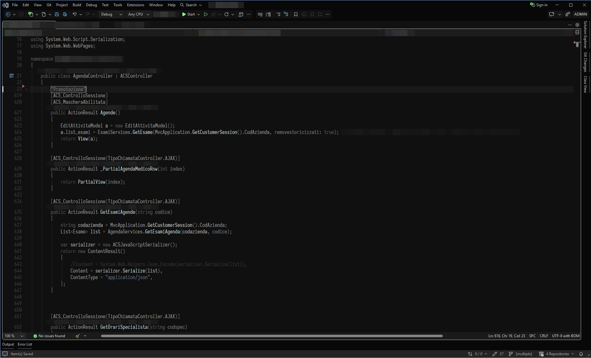

# Visual Studio 2026
Lackluster themes for Visual Studio 2026 (v18), packaged as a VSIX extension. It adds five themes
under **Tools > Theme**, one per nvim variant:

| VS theme         | nvim colorscheme    |
| ---------------- | ------------------- |
| Lackluster       | `lackluster`        |
| Lackluster Hack  | `lackluster-hack`   |
| Lackluster Mint  | `lackluster-mint`   |
| Lackluster Night | `lackluster-night`  |
| Lackluster Dark  | `lackluster-dark`   |



## Build and install
Build the VSIX with the MSBuild that ships with Visual Studio (adjust the edition in the path):
```
"C:\Program Files\Microsoft Visual Studio\18\Community\MSBuild\Current\Bin\MSBuild.exe" Lackluster.VS\Lackluster.VS.csproj -restore -p:Configuration=Release
```
Double-click `Lackluster.VS\bin\Release\Lackluster.VS.vsix`, restart Visual Studio, and pick a
theme in **Tools > Theme**.

## How the themes are generated
`generate.py` writes `Lackluster.VS/Themes/*.pkgdef`:

1. It reads every color token of the built-in VS 2026 **Dark** theme from the local install, so
   no part of the IDE keeps its stock colors.
2. Each color is remapped onto the lackluster palette: grays go through a ramp that lands on
   lackluster's backgrounds (`#080808`, `#101010`, `#191919`, `#2a2a2a`, ...), and colored
   tokens get the hue of the nearest lackluster accent (lack, green, yellow, orange, red).
3. Explicit overrides mirror `lua/lackluster/highlight.lua`: editor background, cursor line,
   line numbers, selection, search, diagnostics, diff, the VS 2026 shell, and syntax
   classifications for C#, C++, XML/XAML/HTML/CSS and SQL.

| nvim highlight               | VS classifications                                   |
| ---------------------------- | ---------------------------------------------------- |
| `@function`                  | method name, extension method name, cppFunction, ... |
| `@keyword`                   | Keyword, preprocessor keyword                        |
| `@keyword.return/exception`  | keyword - control                                    |
| `@string`                    | String, string - verbatim, attribute values          |
| `@string.escape`             | string - escape character, regex                     |
| `@type`                      | class/struct/interface/enum/delegate/namespace names |
| `@variable.member`           | field, property, event names                         |
| `@variable.parameter`        | parameter name                                       |
| `@constant`, `@number`       | Number, constant name, enum member name              |
| `@operator`, `@punctuation`  | Operator, punctuation                                |
| `@tag`, `@tag.attribute`     | XML/HTML element and attribute names                 |

To regenerate after changing the palette or mappings (needs Python 3 and VS 2026):
```
python generate.py
```
Pass `--vs "<install path>"` if Visual Studio isn't found automatically.

## Differences from nvim
* VS keeps syntax colors on selected text instead of inverting it, so the selection is
  `#444444` rather than `#cccccc` with black text.
* VS uses a single classification for function definitions and calls, so all method names use
  the `@function` color (the same thing nvim shows with LSP semantic tokens on).
* Shell accents (primary buttons, checkboxes, focus) use `#cccccc` with near-black text, like
  the active tab in nvim.
